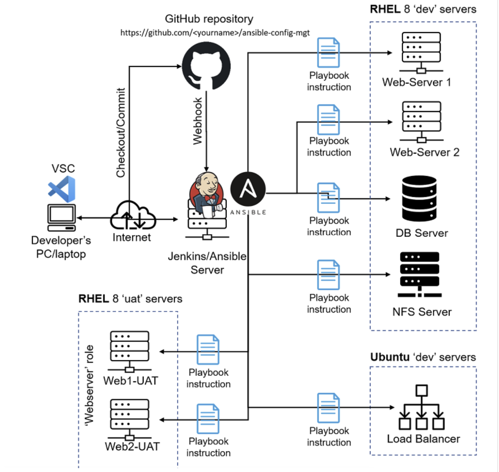
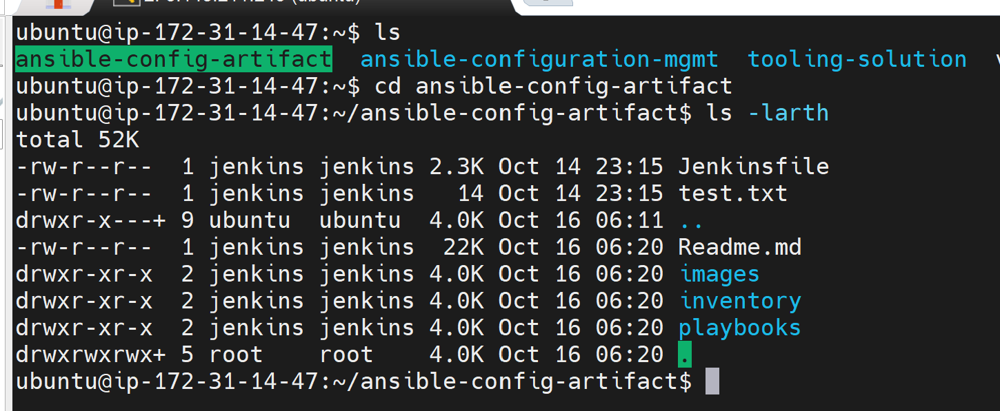
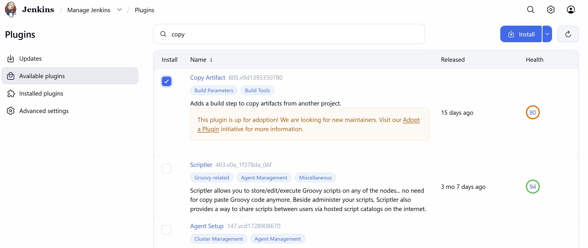
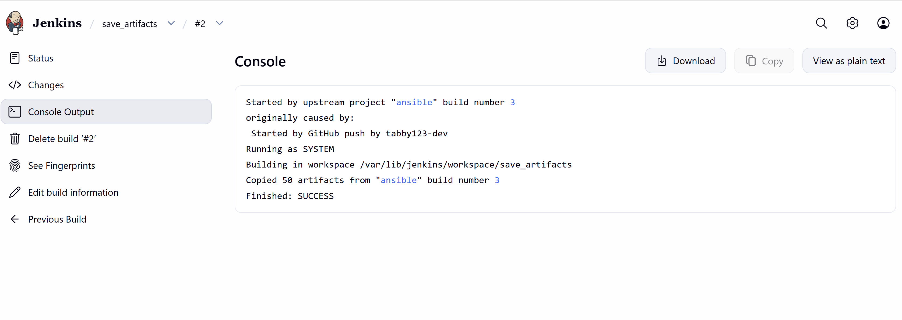
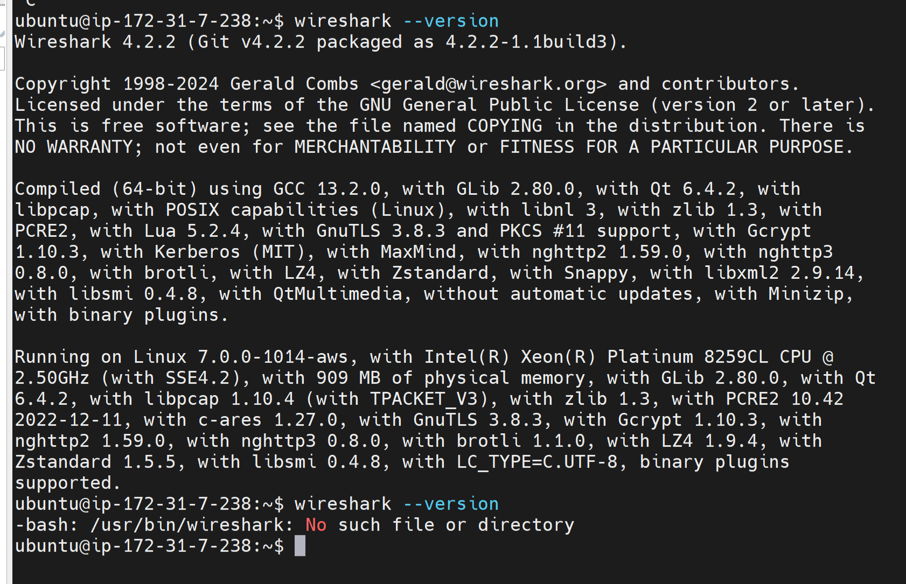
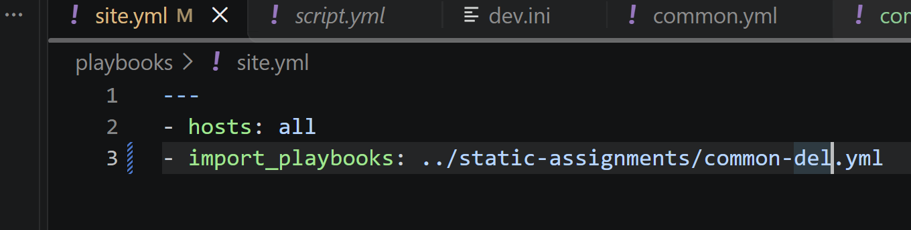
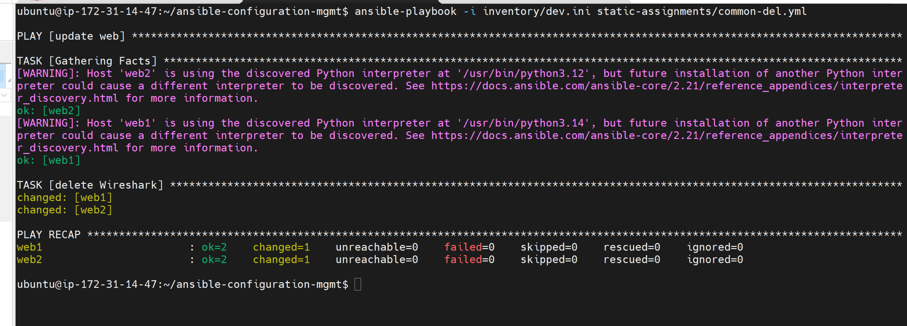
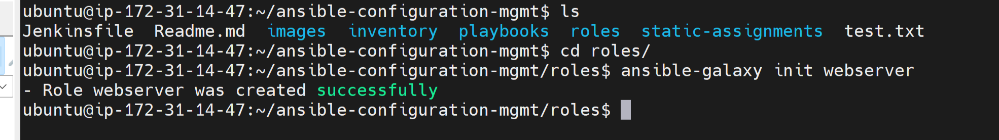
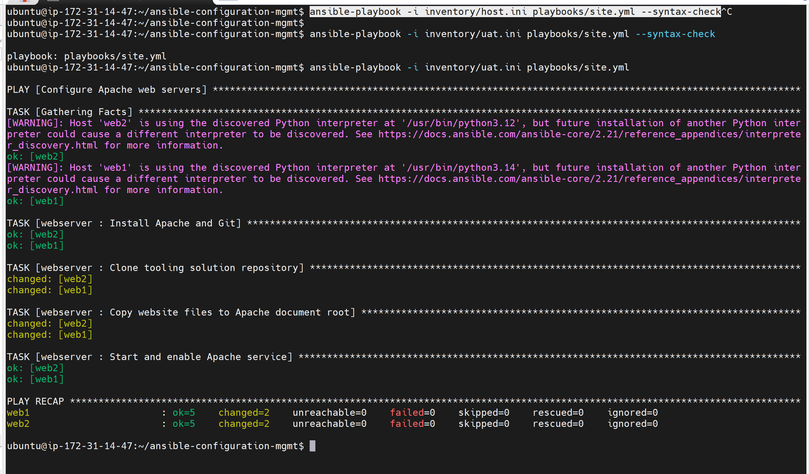

# Ansible Refactoring & Static Assignments (Imports and Roles)

> **Project 12 | DevOps / Cloud Engineering**  
> Automating infrastructure configuration with **GitHub, Jenkins, and Ansible** across development and UAT environments.

## Project overview

This project demonstrates how I organized Ansible automation into reusable playbooks and roles, improved a Jenkins artifact workflow, and prepared automated configuration of two RHEL 8 UAT web servers. The implementation follows the project brief shown in the accompanying assignment screenshots. 

### Objectives

- Improve Jenkins build-artifact handling using a downstream `save_artifacts` job.
- Refactor a monolithic Ansible playbook into imported playbooks through `site.yml`.
- Separate inventory by environment (`dev`, `uat`, `stage`, `prod`).
- Create a reusable `webserver` role for Apache and website deployment.
- Configure two RHEL 8 UAT EC2 instances and validate web access.


## Architecture

```text
Developer (VS Code)
       |
       | Git push / pull request / merge
       v
GitHub: ansible-config-mgt
       |
       | webhook
       v
Jenkins / Ansible control server
       |-- ansible job (checkout/build)
       |-- save_artifacts job (copy successful build artifacts)
       |-- /home/ubuntu/ansible-config-artifact
       |
       | ansible-playbook -i inventory/uat.yml playbooks/site.yml
       v
UAT inventory
       |-- Web1-UAT (RHEL 8 / Apache)
       `-- Web2-UAT (RHEL 8 / Apache)

Other existing inventory targets: dev web, database, NFS and Ubuntu load balancer.
```



## Tools and technologies

| Tool | Purpose |
|---|---|
| AWS EC2 / RHEL 8 | UAT web server infrastructure |
| Ubuntu | Jenkins / Ansible control host (as described in the lab) |
| Ansible | Agentless server configuration |
| Jenkins | CI job execution and artifact handoff |
| GitHub / Git | Version control and webhook trigger |
| Apache HTTP Server (`httpd`) | Web application hosting |
| VS Code / SSH agent | Development and secure remote access |

## Repository structure

```text
ansible-config-mgt/
├── inventory/
│   ├── dev.yml
│   ├── uat.yml
│   ├── stage.yml
│   └── prod.yml
├── playbooks/
│   └── site.yml
├── static-assignments/
│   ├── common.yml
│   └── common-del.yml
├── roles/
│   └── webserver/
│       ├── README.md
│       ├── defaults/main.yml
│       ├── handlers/main.yml
│       ├── meta/main.yml
│       ├── tasks/main.yml
│       └── templates/
├── screenshots/
└── README.md
```

## 1. Enhance Jenkins artifact management

Create the destination directory on the Jenkins/Ansible server:

```bash
sudo mkdir -p /home/ubuntu/ansible-config-artifact
sudo chown jenkins:jenkins /home/ubuntu/ansible-config-artifact
sudo chmod 0755 /home/ubuntu/ansible-config-artifact
```



Jenkins configuration:

1. Install the **Copy Artifact** plugin.
2. Keep the existing Freestyle job named `ansible` for repository checkout.
3. Create a second Freestyle job named `save_artifacts`.
4. Configure `save_artifacts` to run after a **successful** `ansible` build.
5. In `save_artifacts`, add **Copy artifacts from another project**, selecting `ansible` as the source and the appropriate successful build selector.
6. Copy the files into the destination used by your Ansible runner. Note that the Copy Artifact plugin normally copies into a job workspace; use a controlled shell or deployment step to synchronize them to an **absolute path** if required.
7. Set build retention limits to avoid unnecessary disk usage.






## 2. Refactor playbooks with imports

The `site.yml` file acts as the entry point and imports a task-specific playbook.This particular task required we install wireshirk package on teh webservers

**`playbooks/site.yml` — import shared configuration**

```yaml
---
- import_playbook: ../static-assignments/common.yml
```


This steps deleted the wireshirk package installed in the first command.

```yaml
---
- import_playbook: ../static-assignments/common-del.yml
```




```yaml
---
- name: Remove Wireshark from development hosts
  hosts: webservers:nfs:db
  become: true
  tasks:
    - name: Remove Wireshark on Red Hat family hosts
      ansible.builtin.yum:
        name: wireshark
        state: absent
      when: ansible_facts['os_family'] == 'RedHat'
```

Run against the development inventory:

```bash
cd /home/ubuntu/ansible-config-artifact
ansible-playbook -i inventory/dev.yml playbooks/site.yml
```

Check removal on applicable hosts:

```bash
wireshark --version
# Expected after removal: command not found
```
## 3. Create a reusable webserver role

To avoid repeating Apache setup instructions, I introduced an Ansible role named `webserver`.

From the repository root:

```bash
mkdir -p roles
cd roles
ansible-galaxy role init webserver
```

The generated role includes `tasks`, `handlers`, `defaults`, `meta`, and other standard directories. Unused directories can be removed.

**`ansible.cfg`** include the roles directory:

```ini
[defaults]
roles_path = ./roles
```



## 4. Configure the UAT inventory

I provisioned two RHEL 8 EC2 instances named `Web1-UAT` and `Web2-UAT` for the UAT environment.
**`inventory/uat.yml`**

```yaml
---
all:
  children:
    uat_webservers:
      hosts:
        web1-uat:
          ansible_host: <WEB1_PRIVATE_IP>
        web2-uat:
          ansible_host: <WEB2_PRIVATE_IP>
      vars:
        ansible_user: ec2-user
```


```bash
ssh-add -l
ansible -i inventory/uat.yml uat_webservers -m ping
```

## 5. Implement the Apache webserver role

The `webserver` role installs Apache and Git, deploys website content to `/var/www/html`, and starts/enables the `httpd` service.

**`roles/webserver/defaults/main.yml`**

```yaml
---
tooling_repo_url: "https://github.com/<YOUR_GITHUB_USERNAME>/tooling.git"
web_root: /var/www/html
```

**`roles/webserver/tasks/main.yml`**

```yaml
---
- name: Install Apache and Git
  become: true
  ansible.builtin.dnf:
    name:
      - httpd
      - git
    state: present

- name: Deploy tooling website
  become: true
  ansible.builtin.git:
    repo: "{{ tooling_repo_url }}"
    dest: "{{ web_root }}"
    version: main
    force: true
  notify: Restart Apache

- name: Ensure Apache is running and enabled
  become: true
  ansible.builtin.service:
    name: httpd
    state: started
    enabled: true
```

**`roles/webserver/handlers/main.yml`**

```yaml
---
- name: Restart Apache
  become: true
  ansible.builtin.service:
    name: httpd
    state: restarted
```
**`static-assignments/uat-webservers.yml`**

```yaml
---
- name: Configure UAT web servers
  hosts: uat_webservers
  roles:
    - webserver
```

**`playbooks/site.yml` — UAT deployment**

```yaml
---
- import_playbook: ../static-assignments/uat-webservers.yml
```



## 6. Commit, merge, and deploy

I used a feature branch to organize the refactor and reviewed changes before merging into the repository's default branch.

```bash
git checkout -b refactor
git add .
git commit -m "Refactor Ansible playbooks and add UAT webserver role"
git push -u origin refactor
```

Create a pull request in GitHub, review it, and merge into `main`  if that is the repository's actual default branch). The GitHub webhook should trigger the `ansible` job, followed by `save_artifacts`.

On the Ansible control server, after confirming that the updated files are available:

```bash
cd /home/ubuntu/ansible-config-artifact
ansible-playbook --syntax-check -i inventory/uat.yml playbooks/site.yml
ansible-playbook -i inventory/uat.yml playbooks/site.yml
```

## 7. Verify deployment

After the playbook completes, I verify the web service and application on **both** UAT hosts.

```bash
ansible -i inventory/uat.yml uat_webservers -b -m command -a "systemctl is-active httpd"
ansible -i inventory/uat.yml uat_webservers -b -m command -a "systemctl is-enabled httpd"
```


## Challenges and lessons learned

- **Artifact consistency:** A dedicated downstream Jenkins job makes it easier to retrieve a known successful configuration build.
- **Code reuse:** `import_playbook` keeps the top-level entry point short while allowing specialized playbooks to evolve independently.
- **Separation of environments:** Distinct inventories reduce the risk of targeting the wrong servers.
- **Reusable roles:** The `webserver` role centralizes installation, deployment, and service management.
- **Secure operations:** SSH agent forwarding and least-privilege filesystem permissions are preferable to storing credentials in the repository or making artifact folders world-writable.
- **Validation:** Successful CI builds do not automatically prove that UAT servers were configured; Ansible output and browser tests provide separate deployment evidence.


## Outcome

This project showcases a maintainable approach to configuration management: GitHub provides version control, Jenkins coordinates the build/artifact workflow, and Ansible applies reusable configuration to environment-specific infrastructure. Once the verification checklist and screenshots are completed, the README will serve as an evidence-backed record of the deployment.

---


