This project demonstrates the use of Ansible Configuration Management to automate the setup, configuration, and deployment of a web application infrastructure. It replaces repetitive manual tasks such as server provisioning, software installation, configuration, and application deployment with Ansible playbooks written in YAML, improving consistency, efficiency, and scalability across multiple servers.

We plan to achieve this architecture at the end of the project.
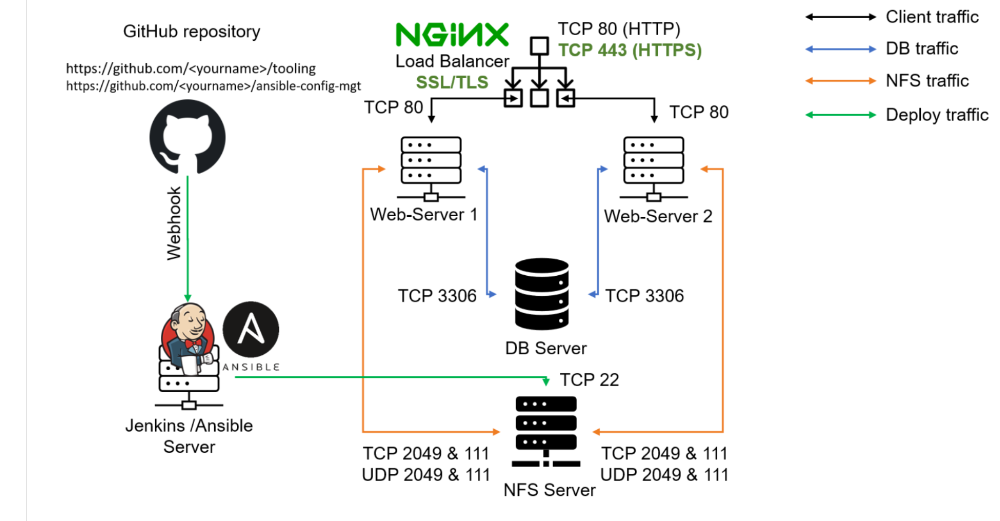

##  Step1:Install and configure ansible on an EC2 Instance.
For this step we are building on our previous project where we had configured the jen kins server.
Note:The serevers hosting the ansible and jenkins  can be  different but for our case we are using one server for both.

Install ansible on teh server.

```bash
sudo apt update
sudo apt install ansible
ansible --version
```
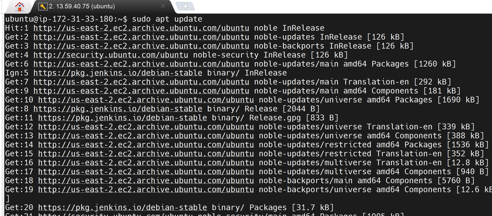
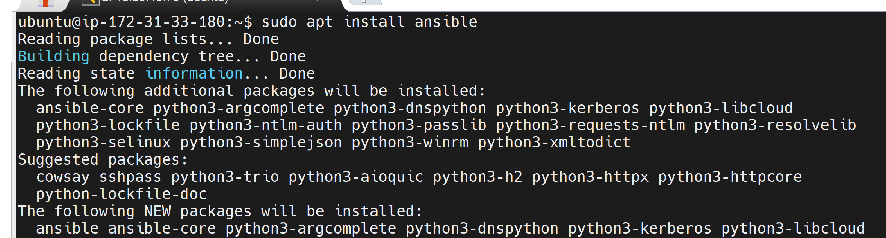
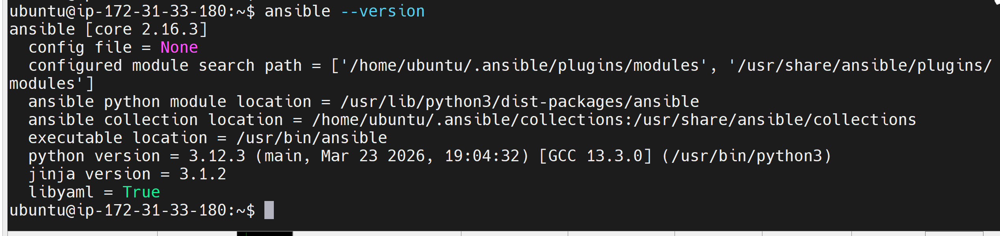

##  Step 2:Create a new repository in github to host the ansible-configuration file 
ON git crete a new repo and name it ansible-configuration-mgmt.
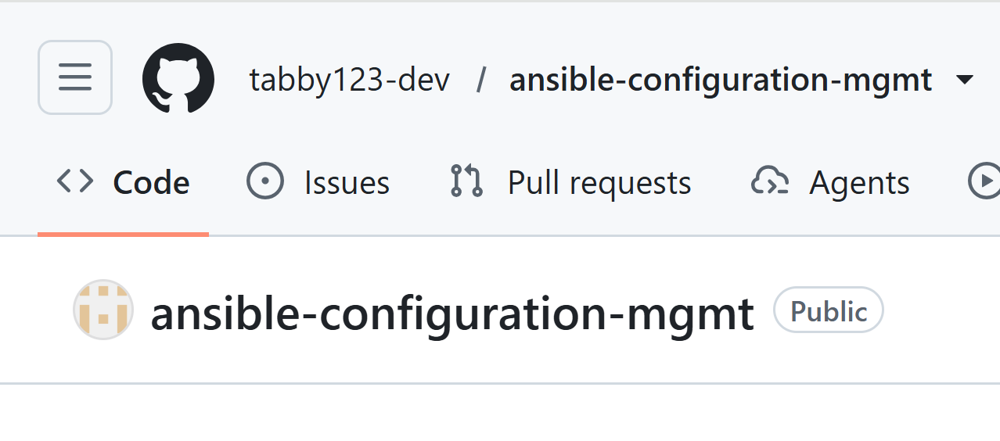

## Step 3: Configure a new jenkins job to connect to your repo and archive the repo contents everytime you make a change to the repo or push to the ansible repo.
- On the jenkins server create a new freestyle project called ansible-job.
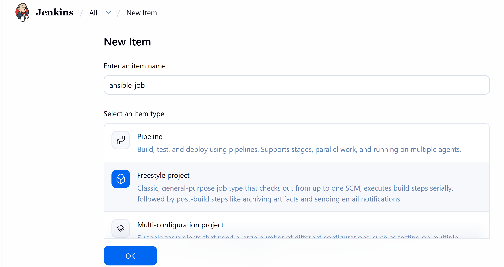

- connect the jenkins ansible-job to your github Repo.On the source code management tab in jenkins add repository and the credentisl to access the repo
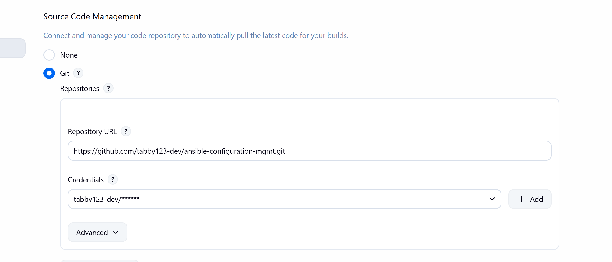

- Configure a webhook in github and set to to trigger a build on any change/push to the repo.
On Github under teh repository setting go to webhoook and add a webhook.Specify the PayloadURL which is the jenkins server url:
```bash 
http://public ip of the jenkins server:8080/jenkinserver/github-webhook/
```
Specisfy the content type as :
```bash
application/json
```
Click Add webhook
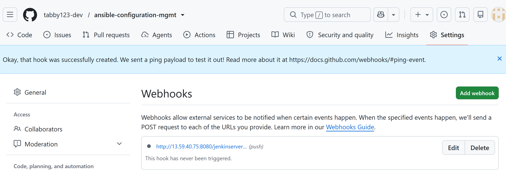

- Configure a post build job to save all the buils artifacts from teh repo to the jenkins server on this folder:
```bash
 ls /var/lib/jenkins/jobs/ansible-job/builds/<buils numer>
 ```
 - On the Ansible job configure the Post build action on the job to archive all artifacsts form the repository
 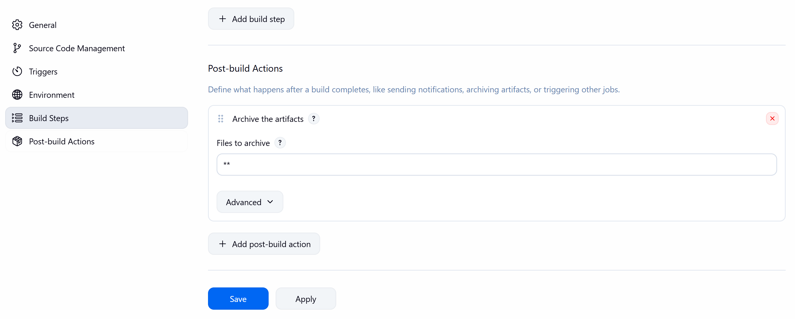

 - Change something in the readme.md of the ansible-config repo and observer the jenkins job.
  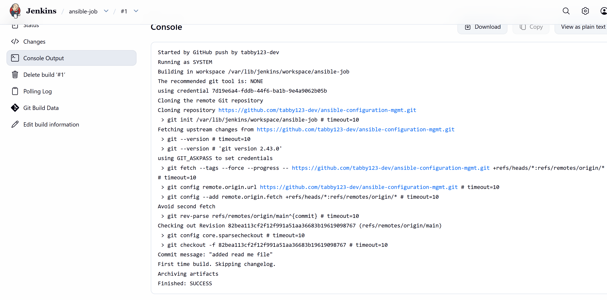
  - Check the artifacts
  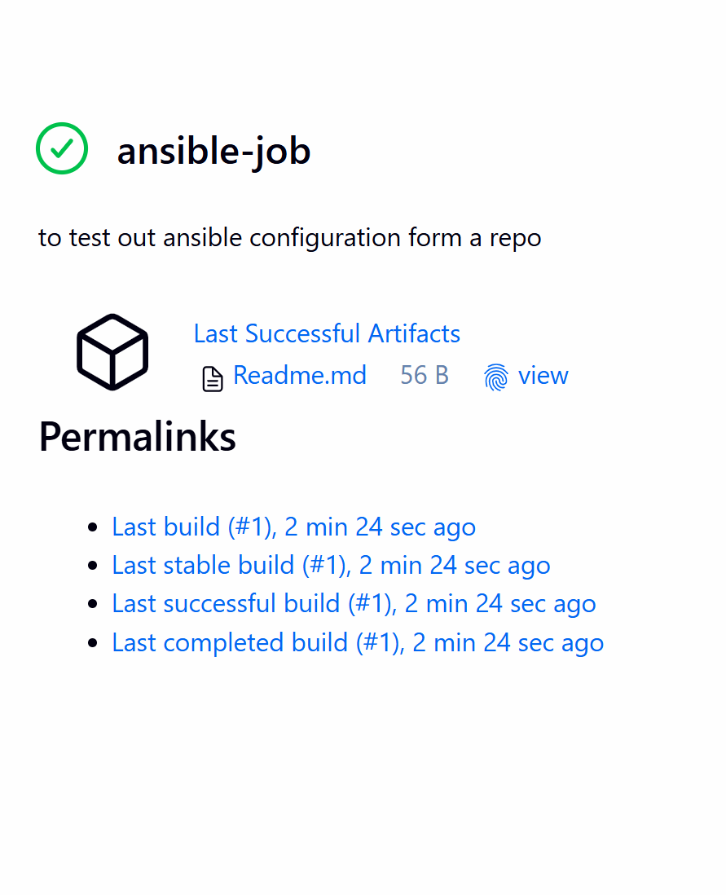
  - confirm the buils artifact is saved in the specified folder above.
    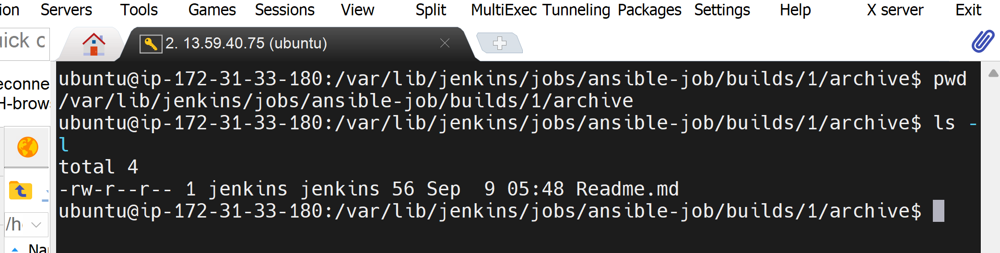
-- This confirms taht our new repor is succesfullt connected to jenkins and works as expected.